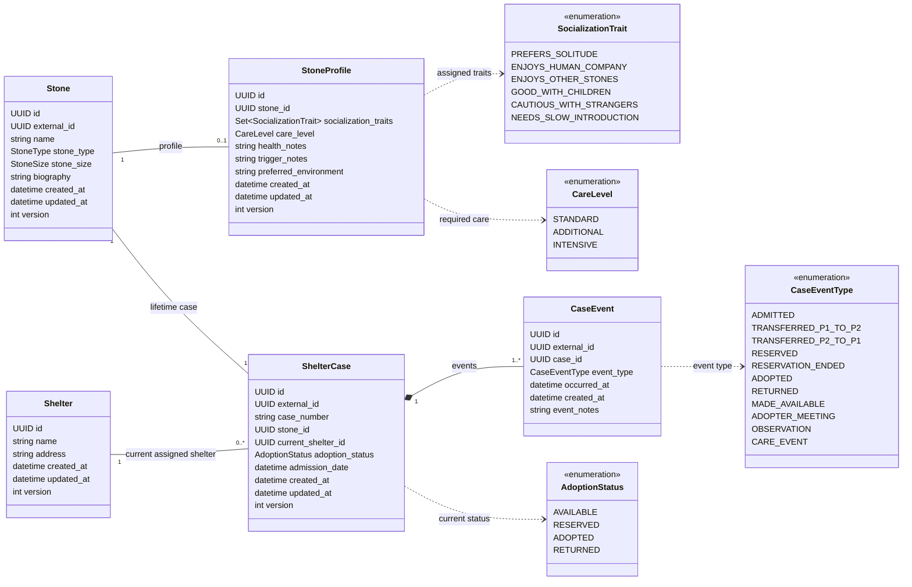
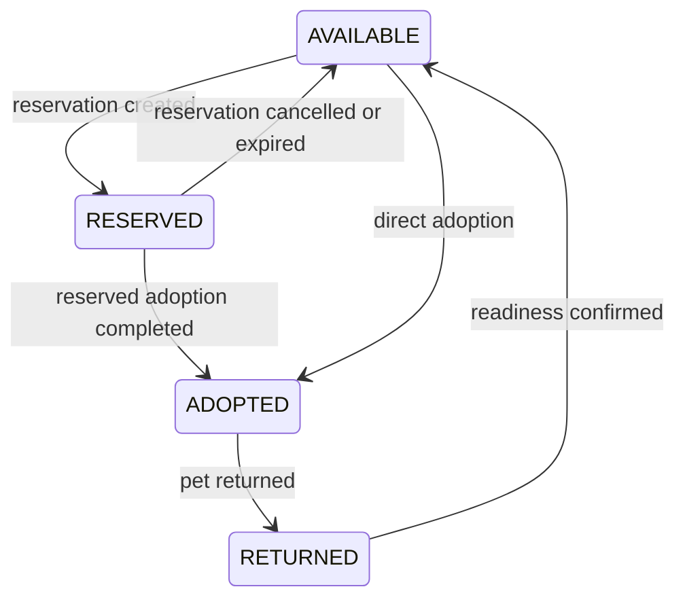

# Shelter domain model

- Status: Current agreed model and implemented single-stone registration contract through PY-010
- Tracking: [PY-010](https://github.com/PreChatGPTSenior/stone-shelter-lab-py/issues/12); original model agreed in [PY-008](https://github.com/PreChatGPTSenior/stone-shelter-lab-py/issues/8)
- Basis: [lifetime cases](../adr/0007-lifetime-shelter-case-identity.md), [external ingestion](../adr/0008-external-batch-ingestion-and-partial-updates.md), and [fictional profiles](../adr/0009-fictional-pet-stone-profiles.md)
- Current implementation direction: [PY-009 happy-path loading](../adr/0010-py-009-test-data-preparation.md) and [DTO-to-ORM mapping](../adr/0011-dto-to-orm-without-domain-dataclasses.md)
- Current ingestion boundary: [one stone per request](../adr/0013-single-stone-ingestion.md); multi-stone API batches are not supported.

## Purpose and boundaries

This is a fictional world where stones are pets. Personality, health, traumatic experiences, and care needs are authored facts of this world, not claims about real geology.

The application is a central hub for shelter employees, initially serving two shelters. An external service supplies stone data and events. The future assistant will help employees find suitable pets and explain recommendations using current profiles, case history, and reference documents.

This document is the source of truth for entities, relationships, field ownership, and the current registration contract. Attribute names use Python conventions; accepted JSON aliases and implemented storage details are recorded below. It is not executable DDL. Earlier ADRs provide decision history; current accepted decisions supersede historical ingestion proposals.

## Entity relationships

Nullable fields are identified in the field dictionaries below. Enum attributes in the diagram describe domain types; their implemented string and array representations are recorded below.

### Relationship rules

- A Stone has at most one StoneProfile. Every profile belongs to exactly one stone. A profile is optional at creation and can be supplied later through a partial update.
- Every registered Stone has exactly one lifetime ShelterCase, and every case belongs to exactly one stone. Registration requires the case and persists both in one transaction. The unique non-null stone_id foreign key prevents orphan cases and multiple cases per stone; the mandatory case on the stone side is enforced by the registration DTO and service, not by that foreign key alone.
- Every case references exactly one current shelter. One shelter can have many cases.
- Every CaseEvent belongs to exactly one case. A case has a collection of events, without a separate history container or field-change records. New ingestion requires 1 to 100 events containing ADMITTED in any position.
- CaseEvent has no direct shelter relationships. Its CaseEventType identifies the direction of a transfer between the two known shelters.
- Profile information belongs to the stone and remains with it across returns, transfers, and status changes.
- Composition expresses event ownership, not permission to delete records. Physical deletion is outside the integration scope.

## Entities and fields

### Shared technical fields

| Field | Applies to | Meaning |
| --- | --- | --- |
| `created_at` | Stone, StoneProfile, Shelter, ShelterCase, CaseEvent | When the row was created in the hub database. Provided by CreatedAtMixin. |
| `updated_at` | Stone, StoneProfile, Shelter, ShelterCase | When that row was last updated. Provided by UpdatedAtMixin; initialized on insertion. |

Both fields are non-null timezone-aware timestamps. PostgreSQL supplies their initial values through `DEFAULT now()`. SQLAlchemy includes `updated_at = now()` in updates when no explicit value is supplied. This is not a database UPDATE trigger: independent SQL writers must set the update timestamp themselves or use a separately designed database mechanism.

PostgreSQL `now()` is the transaction-start timestamp; multiple operations within a transaction can have the same technical timestamp. These fields are not concurrency versions or upstream ordering tokens. Updating a profile or adding an event does not automatically update its stone or case timestamp.

CaseEvent uses `created_at` instead of the earlier `recorded_at` name. It has no `updated_at` because the current flow appends events without editing them. `occurred_at` remains the source-provided time of the actual event, distinct from registration in the hub. These shared timestamps are not repeated in every entity field table below.

`id` is an internal UUID generated by the shared ORM Base at insertion. It is not copied from source IDs. Registration creates child foreign keys through object relationships; the source sends external IDs and the current existing shelter UUID.

`version` is a non-null integer supplied by VersionedMixin on Stone, StoneProfile, Shelter, and ShelterCase. SQLAlchemy initializes it to 1 and increments it for ORM-managed row updates, checking the previous version for optimistic concurrency. It is not an incoming source version, a technical timestamp, or a version of the entire graph. Bulk SQL updates bypass this automatic ORM version check. CaseEvent has no version or updated_at because events are append-only in the current design.

### Implemented representation and input normalization

- StoneType, StoneSize, AdoptionStatus, CaseEventType, and CareLevel are Python enums in DTOs and VARCHAR(32) values in ORM storage. No PostgreSQL native enum or enum CHECK constraint is used; the service writes enum values explicitly.
- Socialization traits are a set of enum values in the DTO and a non-null PostgreSQL ARRAY(VARCHAR(32)) in storage. The service writes a sorted list of unique enum values. Omitting socializationTraits creates an empty set; an explicit empty array is accepted, while null is not. The database array itself does not enforce set uniqueness for independent SQL writers.
- Input string fields inherit whitespace trimming from ApiRequest. Name, caseNumber, and eventNotes require at least one character after trimming. Optional biography and profile text may be null or omitted; blank text is trimmed to an empty string rather than converted to null.
- Name is limited to 120 characters in the DTO and VARCHAR(120) column. Biography is optional and limited to 2048 characters in the DTO and VARCHAR(2048) column.
- Case numbers, event notes, shelter names and addresses, and profile notes/environment use SQL TEXT columns. The current registration DTO adds no maximum length for caseNumber, eventNotes, or profile text fields. Shelter setup uses reference JSON rather than a shelter-creation HTTP DTO.
- Adoption status must be supplied explicitly. Neither the registration DTO nor ShelterCaseModel provides an AVAILABLE default. The service preserves the supplied value without replaying events.
- Incoming admissionDate and occurredAt must include a timezone. ORM columns are non-null timezone-aware timestamps. Internal IDs, technical timestamps, and versions are not accepted as writable fields in the DTO; extra input fields are ignored by ApiRequest.

### Stone

| Field | Type | Required | Meaning and constraints |
| --- | --- | --- | --- |
| `id` | UUID | Yes | Internal primary key used by local relationships. |
| `external_id` | UUID | Yes | Unique stone identifier supplied by the external service. |
| `name` | String, 1–120 characters | Yes | Pet name; surrounding whitespace is trimmed. |
| `stone_type` | StoneType | Yes | Existing catalog stone-type vocabulary. |
| `stone_size` | StoneSize | Yes | Existing catalog size vocabulary. |
| `biography` | String, up to 2048 characters | No | General description of the pet; nullable and stored as VARCHAR(2048). |

Stone has no admission date and no adoption status. Admission belongs to the case lifecycle; the current adoption status belongs to ShelterCase.

### StoneProfile

| Field | Type | Required | Meaning and constraints |
| --- | --- | --- | --- |
| `id` | UUID | Yes | Internal primary key. |
| `stone_id` | UUID, FK to Stone | Yes | Unique reference enforcing at most one profile per stone. |
| `socialization_traits` | Set of SocializationTrait | Optional in input; non-null in storage | Omission defaults to an empty set. An empty set means no traits have been recorded. |
| `care_level` | CareLevel | No | Current care intensity. Null means not yet assessed. |
| `health_notes` | Text | No | Health details, chronic conditions, and care context. |
| `trigger_notes` | Text | No | Known triggers, traumatic experiences, and relevant reactions. |
| `preferred_environment` | Text | No | The pet's preferences for its future family and home. |

The profile has no separate external identifier: it is identified by its stone in the source integration. Unknown information must not be interpreted as good health, absence of triggers, or universal compatibility. Profile text currently has no maximum length in the DTO, uses SQL TEXT, and follows the normalization rules above. A missing or null profile creates no profile row; an empty profile object creates a row with empty traits and unknown care/notes.

### Shelter

| Field | Type | Required | Meaning and constraints |
| --- | --- | --- | --- |
| `id` | UUID | Yes | Primary key referenced by cases. |
| `name` | String | Yes | Shelter name. |
| `address` | String | Yes | Shelter address. |

Begin with the two persisted shelter records in fixtures/shelters.json. The source references their UUID through shelterCase.currentShelterId. P1 is b222288c-1da8-4932-a7eb-75a55be41b87 (Pebble Haven); P2 is 10ad5165-1b0c-4255-bfb8-ef6979d10e2b (Quiet Quarry). Coordinates, distance search, shelter areas, and staff-account management are outside this model.

### ShelterCase

| Field | Type | Required | Meaning and constraints |
| --- | --- | --- | --- |
| `id` | UUID | Yes | Internal primary key. |
| `external_id` | UUID | Yes | Globally unique case identifier supplied by the external service. |
| `case_number` | String | Yes | Unique, immutable, human-readable number, such as `0001-2026-P1`. |
| `stone_id` | UUID, FK to Stone | Yes | Unique reference enforcing one lifetime case per stone. |
| `current_shelter_id` | UUID, FK to Shelter | Yes | Shelter currently responsible for the case. |
| `adoption_status` | AdoptionStatus | Yes | Current adoption state supplied as required `shelterCase.adoptionStatus`; never reconstructed from imported history. |
| `admission_date` | Timezone-aware datetime | Yes | First admission recorded for this lifetime case, supplied by the source. |

#### Registration field ownership

The external system owns the current case snapshot. Registration validates and stores its required `adoptionStatus`; it does not infer, default, or overwrite that status from event types, timestamps, or array order. See [ADR-0015](../adr/0015-source-owned-adoption-status.md).

| Entity field | Incoming JSON | Value source |
| --- | --- | --- |
| `id` | Not accepted as an internal ID | Generated internal UUID |
| `external_id` | `shelterCase.externalId`, required | External system |
| `case_number` | `shelterCase.caseNumber`, required | External system |
| `stone_id` | No separate field | Linked to the stone created in this request through the ORM relationship |
| `current_shelter_id` | `shelterCase.currentShelterId`, required | External system; references an existing shelter |
| `adoption_status` | `shelterCase.adoptionStatus`, required enum | External system |
| `admission_date` | `shelterCase.admissionDate`, required aware datetime | External system |
| `created_at`, `updated_at`, `version` | Not supplied | Application/database-managed technical fields |
| `events` | `shelterCase.events`, required | External event facts stored as related records |

A return or transfer preserves the case UUID and number. A transfer changes the current shelter; it does not rewrite the number, first admission date, or previous transfer directions. The number is an opaque source-provided string: preserve leading zeros and do not derive the current shelter from its suffix.

The current shelter represents case responsibility and remains assigned even while the pet is adopted. Repeated arrivals and transfers are recorded in case events. Case identity and number conflicts must not silently merge different cases.

`current_shelter_id` is the persisted foreign-key column. An ORM attribute named `current_shelter` is navigation to the related Shelter object, not another database column or a second shelter assignment. Both can exist in the ORM model while representing the same association.

### CaseEvent

| Field | Type | Required | Meaning and constraints |
| --- | --- | --- | --- |
| `id` | UUID | Yes | Internal primary key and stable reference for retrieved evidence. |
| `external_id` | UUID | Yes | Unique source-provided event identifier used to recognize repeated delivery. |
| `case_id` | UUID, FK to ShelterCase | Yes | Owning lifetime case. |
| `event_type` | CaseEventType | Yes | Kind of event. |
| `occurred_at` | Timezone-aware datetime | Yes | When the event occurred according to the source. |
| `created_at` | Timezone-aware datetime | Yes | When this hub registered the event; inherited from CreatedAtMixin. |
| `event_notes` | Text | Yes | Meaningful account of the event and staff observations. |

The earlier `description` field is named `event_notes`. Separate `from_status`, `to_status`, `shelter_id`, `from_shelter_id`, and `to_shelter_id` fields are not part of this revised event model. Event type determines the applicable status operation or transfer direction without separate shelter foreign keys or an additional direction field on the event.

### Transfer direction for the two-shelter scenario

| CaseEventType | Origin | Destination |
| --- | --- | --- |
| `TRANSFERRED_P1_TO_P2` | Shelter P1 | Shelter P2 |
| `TRANSFERRED_P2_TO_P1` | Shelter P2 | Shelter P1 |

P1 and P2 are stable labels for the two seeded shelter records. Their UUID mapping is specified in fixtures/shelters.json and the Shelter section above; do not derive the mapping from case-number suffixes or current shelter state.

During registration, the application stores the source-provided current shelter and transfer events without replaying location changes. A future operation that changes shelter and appends an event must have an explicit contract and rules, and persist both atomically. The transfer does not itself change adoption status. The event type remains stored in history after later moves, so its direction is not inferred from the case's current location.

This explicit two-route vocabulary is intentional for the current educational scenario. Adding more shelters would require revisiting it. No new generic routing subsystem or extra lifecycle validation is required for the agreed consistent-input happy path.

## Socialization traits

Traits form a set, not a mutually exclusive classification or numeric score.

| Value | Meaning |
| --- | --- |
| `PREFERS_SOLITUDE` | Prefers spending time alone; this does not itself imply aggression or inability to live with others. |
| `ENJOYS_HUMAN_COMPANY` | Enjoys the company of people. |
| `ENJOYS_OTHER_STONES` | Enjoys the company of other pet stones. |
| `GOOD_WITH_CHILDREN` | Interacts well with children. |
| `CAUTIOUS_WITH_STRANGERS` | Is wary of unfamiliar people. |
| `NEEDS_SLOW_INTRODUCTION` | Needs gradual introductions to unfamiliar companions. |

Enjoying human company and being cautious with strangers can coexist. An empty set means no recorded traits, not a negative assessment of social skills. Compatibility with specific stone types belongs in a separate fictional reference document, not this enum.

## Care levels

| Value | Meaning | Fictional example |
| --- | --- | --- |
| `STANDARD` | Ordinary care requirements. | Standard shelter and home conditions. |
| `ADDITIONAL` | Regular additional care or support. | Periodic polishing, special bedding, or adaptation support. |
| `INTENSIVE` | Frequent care and increased attention. | Recovery from damage with several care procedures each day. |

Care level is a single current assessment. Null means not yet assessed; do not default it to `STANDARD`. Health details remain in `health_notes`. A chronic condition does not automatically imply intensive care. Care level is independent of adoption status: a pet requiring intensive care can still be `AVAILABLE` for a suitable family.

## Adoption lifecycle

| Status | Meaning | Available for a new adoption or reservation |
| --- | --- | --- |
| `AVAILABLE` | Ready for adoption. | Yes |
| `RESERVED` | Reserved for a potential adopter. | No |
| `ADOPTED` | Currently adopted. | No |
| `RETURNED` | Returned and awaiting readiness for adoption again. | No |

`RETURNED` is a distinct current status, not an immediate transition to `AVAILABLE`. A returned pet might need quarantine, recovery, or assessment before becoming available. No separate quarantine status is introduced here. Readiness is a separate decision supplied by the source.

The return is also a historical event, so it remains discoverable after later status changes. `UNDER_REVIEW` is replaced by the agreed vocabulary above. Registration stores the source-provided current adoption status. History may accompany registration or arrive later through the planned event operation. ADMITTED records admission; its presence never resets or computes the imported current status.

## Case event types

| Value | Meaning | Useful description content |
| --- | --- | --- |
| `ADMITTED` | First admission. | Arrival context and initial observations. |
| `TRANSFERRED_P1_TO_P2` | Transfer from shelter P1 to shelter P2. | Transfer reason and adaptation context. |
| `TRANSFERRED_P2_TO_P1` | Transfer from shelter P2 to shelter P1. | Transfer reason and adaptation context. |
| `RESERVED` | Reservation created. | Reservation context. |
| `RESERVATION_ENDED` | Reservation ended without adoption. | Cancellation or expiration, with a reason if supplied. |
| `ADOPTED` | Adoption completed. | Relevant home conditions and handover observations. |
| `RETURNED` | Return after adoption. | Return reasons, condition, and observations. |
| `MADE_AVAILABLE` | Readiness for adoption confirmed. | What changed after return or a period of care. |
| `ADOPTER_MEETING` | Meeting with potential adopters. | Reactions, successful interactions, and discomfort. |
| `OBSERVATION` | Staff observation. | Behavior, socialization, or reactions to surroundings. |
| `CARE_EVENT` | Health or care event. | Assessment, quarantine, recovery, or care provided. |

Events describe the pet's life, not an audit log of field assignments. There are no `ChangeDetails` records containing field paths and old/new JSON values in this model. Ten adopter meetings are ten events even if the current status never changes.

## Incremental ingestion and case history

The integration simulates an existing operational system: one stone is registered per request with its case and 1 to 100 life events. The collection must include ADMITTED in any position and may contain accumulated history. Profiles may arrive with the stone or later. Subsequent events continue to arrive throughout each pet's life without callers resending the initial admission or the entire history.

| Operation | Accepted information |
| --- | --- |
| Single-stone registration | Required `stone` and `shelterCase`, with an optional `profile`; `shelterCase.adoptionStatus` is a required current-state enum; `shelterCase.events` contains 1 to 100 events, including ADMITTED in any position. No `items` wrapper. |
| Partial update | Changed stone, profile, or case data. A previously absent profile can be added here. |
| Append case events | Future operation for adding events to one existing case; its DTO and acceptance rules will be designed separately. |

For registration, DTO validators use `PydanticCustomError` for two input-dependent acceptance rules: more than 100 events produces `CASE_EVENT_LIMIT_EXCEEDED` with `limit` and `actual` context; a nonempty list without ADMITTED produces `CASE_ADMITTED_EVENT_REQUIRED` with `required_event_type` context. The list still uses a structural minimum length of one, without a generic maximum-length constraint. A custom FastAPI validation-error handler and the final HTTP error envelope are not implemented yet. See [ADR-0013](../adr/0013-single-stone-ingestion.md).

### Dedicated event endpoint

`POST /api/v1/shelter-cases/{external_case_id}/events`

- The path identifies an existing lifetime case by its source-provided UUID, not its internal primary key or human-readable case number.
- This is a planned operation, not an implemented input DTO. Its request limits and response remain contract work.
- The operation appends events rather than replacing the case history.
- Emulator input files may contain multiple registration records, but the emulator sends one stone per request. Each creation payload includes ADMITTED inside `shelterCase.events` and may contain accumulated history. The separate event file supplies later events to individual cases; do not resend already-created events.
- The educational happy path assumes unique, consistent, chronologically ordered events. Duplicate delivery, conflicting content, corrections, and late-event handling are deferred.
- An `OBSERVATION` or `ADOPTER_MEETING` can add history without changing the current status.
- Future operations that change state must explicitly define their rules and state input, and persist any state change and its event atomically. Appending history alone must not imply undocumented status or location calculations.
- Test scenarios with final states other than AVAILABLE include the complete event sequence explaining those states. Each registration atomically persists one stone, its case, optional profile, and supplied events. There is no shared transaction across independent registrations or across creation and a later event request.

### Event facts and future retrieval

- The source supplies events and their factual content. A changed health note does not imply an examination; a changed status does not establish an unknown return reason.
- If one incoming operation includes a state change and its event, persist them in the same transaction.
- Standalone observations and meetings use the dedicated event endpoint without requiring a profile update.
- Duplicate, correction, and out-of-order behavior are future hardening concerns, not prerequisites for the current learning increment.
- Imported history does not calculate current status. Registration preserves the required source-provided adoptionStatus regardless of event order or timestamps. Dates remain facts for display and retrieval; transition validation and application-owned actions require separate explicit rules.
- Observations do not automatically rewrite the current StoneProfile. A reaction during one meeting is evidence; a stable trait or trigger is a separate staff assessment.
- Exact retrieval can use event type, dates, current case state, and transfer direction. Semantic retrieval can use `event_notes` alongside the current profile and reference documents.
- Retrieved notes must retain their CaseEvent identifiers so recommendations can cite specific evidence and its date. No embedding storage fields are added to these domain entities at this stage.

### Learning scenario: new history changes retrieval

1. Register a stone and its case, optionally including a short profile.
2. Run a selection query and retain the result as a baseline.
3. Append a meeting or observation event containing new evidence about the pet.
4. Update the event's search representation when the indexing pipeline is implemented.
5. Repeat the query and evaluate whether the new evidence is retrieved and used appropriately, with a reference to its event.

New evidence can improve retrieval or change a recommendation even when the current profile has not changed. It does not guarantee that the pet becomes a better match; an event may reveal a conflicting preference or trigger.

## Implemented registration boundary

- `POST /api/v1/stones` accepts one required stone and one required shelterCase with an optional profile. The case includes its required source-provided adoptionStatus and 1 to 100 events containing ADMITTED anywhere in the array.
- JSON aliases include stone.externalId, stone.stoneType, stone.stoneSize, shelterCase.externalId, caseNumber, currentShelterId, adoptionStatus, admissionDate, and event externalId, eventType, occurredAt, eventNotes. Profile aliases are socializationTraits, careLevel, healthNotes, triggerNotes, and preferredEnvironment.
- Success returns HTTP 201 with only `{"id": "<internal stone UUID>"}`. Validation failures currently use FastAPI's HTTP 422 detail envelope, including the existing custom event-list codes. A custom validation-error handler is not implemented.
- Each request saves the stone, required lifetime case, optional profile, and events atomically. There is no multi-stone API batch. Current status and current shelter come from the source snapshot; event history is stored without replaying state changes.
- The local application uses persistent Docker Compose PostgreSQL. Database-backed automated tests use Testcontainers exclusively. Reference shelter setup is explicit, and the loader submits each fixture through HTTP without automatic retries or duplicate skipping.
- Subsequent partial updates and the dedicated append-events operation are planned; their DTOs, handlers, and state-changing rules are not implemented.

## Remaining contract decisions

- Partial-update payloads, clearing versus omitting fields, and source timestamps or versions for current-state updates. An omitted collection in an update must not accidentally become an empty replacement.
- Append-event payloads, limits, responses, and explicit rules for any operation that changes case state or location.
- Stale deliveries, equal-time conflicts, unchanged payloads, event corrections, duplicate conflicts, and out-of-order handling.
- A dedicated HTTP error contract for persistence failures and any custom validation-error envelope.

Embedding, search, and application-owned adoption actions remain outside the implemented registration increment. These planned capabilities must not be treated as implemented ingestion behavior.
