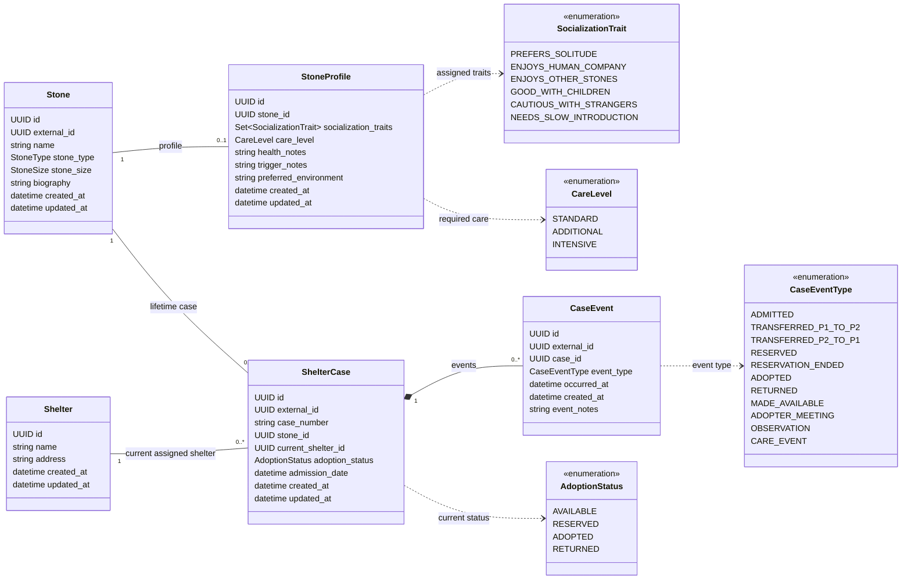
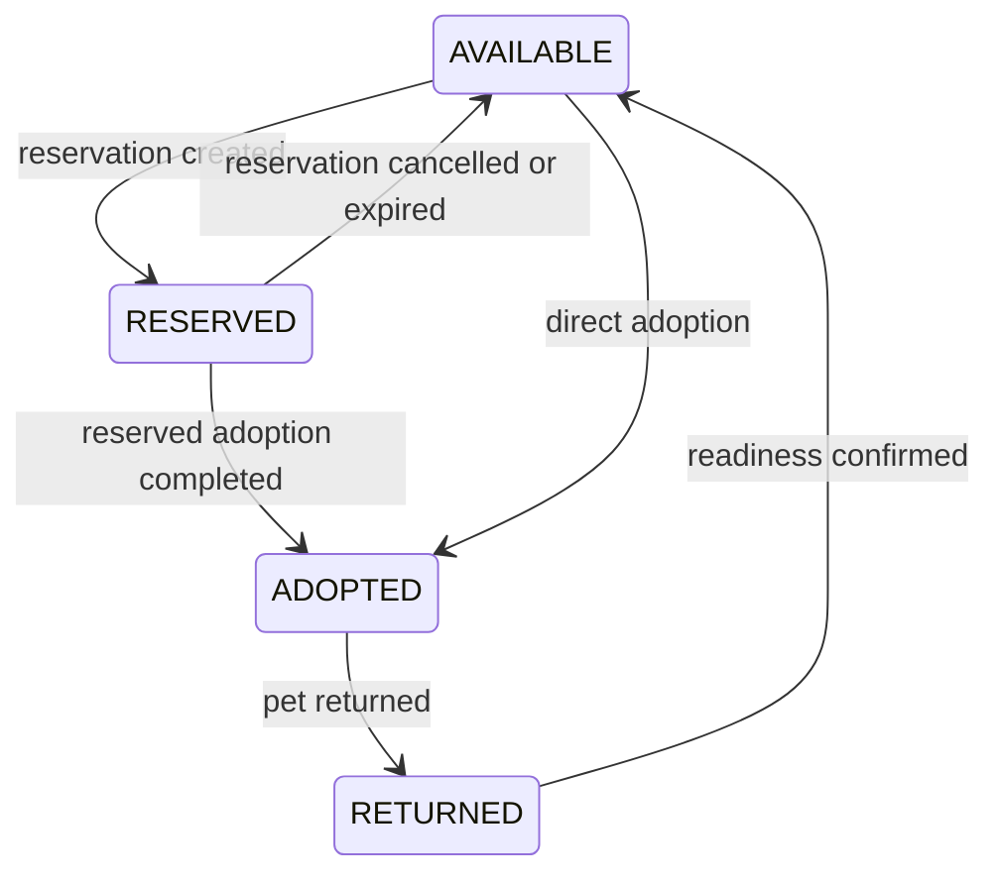

# Shelter domain model

- Status: Agreed domain design for PY-008; implementation and ingestion JSON contracts are pending
- Tracking: [PY-008](https://github.com/PreChatGPTSenior/stone-shelter-lab-py/issues/8)
- Branch: `PY-008-domain-ingestion-contracts`
- Basis: [lifetime cases](../adr/0007-lifetime-shelter-case-identity.md), [external ingestion](../adr/0008-external-batch-ingestion-and-partial-updates.md), and [fictional profiles](../adr/0009-fictional-pet-stone-profiles.md)
- Current implementation direction: [PY-009 happy-path loading](../adr/0010-py-009-test-data-preparation.md) and [DTO-to-ORM mapping](../adr/0011-dto-to-orm-without-domain-dataclasses.md)

## Purpose and boundaries

This is a fictional world where stones are pets. Personality, health, traumatic experiences, and care needs are authored facts of this world, not claims about real geology.

The application is a central hub for shelter employees, initially serving two shelters. An external service supplies stone data and events. The future assistant will help employees find suitable pets and explain recommendations using current profiles, case history, and reference documents.

This document describes entities, relationships, and intended persistence constraints. It is not ORM inheritance, executable DDL, or a finalized HTTP contract. Attribute names use Python conventions; JSON aliases will be specified separately. Earlier linked ADRs provide context; this document records the revised status vocabulary and event-history design agreed during PY-008.

## Entity relationships

Nullable fields are identified in the field dictionaries below. Enum attributes in the diagram do not imply PostgreSQL native enums or a particular collection storage strategy.

### Relationship rules

- A Stone has at most one StoneProfile. Every profile belongs to exactly one stone. A profile is optional at creation and can be supplied later through a partial update.
- A Stone has at most one lifetime ShelterCase. Every case belongs to exactly one stone. Existing catalog-only records can have no case; whether new ingestion requires a case remains contract work.
- Every case references exactly one current shelter. One shelter can have many cases.
- Every CaseEvent belongs to exactly one case. A case has a collection of events, without a separate history container or field-change records.
- CaseEvent has no direct shelter relationships. Its CaseEventType identifies the direction of a transfer between the two known shelters.
- Profile information belongs to the stone and remains with it across returns, transfers, and status changes.
- Composition expresses event ownership, not permission to delete records. Physical deletion is outside the integration scope.

## Entities and fields

### Shared technical timestamps

| Field | Applies to | Meaning |
| --- | --- | --- |
| `created_at` | Stone, StoneProfile, Shelter, ShelterCase, CaseEvent | When the row was created in the hub database. Provided by CreatedAtMixin. |
| `updated_at` | Stone, StoneProfile, Shelter, ShelterCase | When that row was last updated. Provided by UpdatedAtMixin; initialized on insertion. |

Both fields are non-null timezone-aware timestamps. PostgreSQL supplies their initial values through `DEFAULT now()`. SQLAlchemy includes `updated_at = now()` in updates when no explicit value is supplied. This is not a database UPDATE trigger: independent SQL writers must set the update timestamp themselves or use a separately designed database mechanism.

PostgreSQL `now()` is the transaction-start timestamp; multiple operations within a transaction can have the same technical timestamp. These fields are not concurrency versions or upstream ordering tokens. Updating a profile or adding an event does not automatically update its stone or case timestamp.

CaseEvent uses `created_at` instead of the earlier `recorded_at` name. It has no `updated_at` because the current flow appends events without editing them. `occurred_at` remains the source-provided time of the actual event, distinct from registration in the hub. These shared timestamps are not repeated in every entity field table below.

### Stone

| Field | Type | Required | Meaning and constraints |
| --- | --- | --- | --- |
| `id` | UUID | Yes | Internal primary key used by local relationships. |
| `external_id` | UUID | Yes | Unique stone identifier supplied by the external service. |
| `name` | String | Yes | Pet name. |
| `stone_type` | StoneType | Yes | Existing catalog stone-type vocabulary. |
| `stone_size` | StoneSize | Yes | Existing catalog size vocabulary. |
| `biography` | Text | No | General description of the pet. |

Stone has no admission date and no adoption status. Admission belongs to the case lifecycle; the current adoption status belongs to ShelterCase.

### StoneProfile

| Field | Type | Required | Meaning and constraints |
| --- | --- | --- | --- |
| `id` | UUID | Yes | Internal primary key. |
| `stone_id` | UUID, FK to Stone | Yes | Unique reference enforcing at most one profile per stone. |
| `socialization_traits` | Set of SocializationTrait | Yes; may be empty | Staff-assigned traits. An empty set means no traits have been recorded. |
| `care_level` | CareLevel | No | Current care intensity. Null means not yet assessed. |
| `health_notes` | Text | No | Health details, chronic conditions, and care context. |
| `trigger_notes` | Text | No | Known triggers, traumatic experiences, and relevant reactions. |
| `preferred_environment` | Text | No | The pet's preferences for its future family and home. |

The profile has no separate external identifier: it is identified by its stone in the source integration. Unknown information must not be interpreted as good health, absence of triggers, or universal compatibility. Text limits and blank-string handling remain part of contract design.

### Shelter

| Field | Type | Required | Meaning and constraints |
| --- | --- | --- | --- |
| `id` | UUID | Yes | Primary key referenced by cases. |
| `name` | String | Yes | Shelter name. |
| `address` | String | Yes | Shelter address. |

Begin with two persisted shelter records. How the source identifies these records in JSON will be finalized in the ingestion contract. Coordinates, distance search, shelter areas, and staff-account management are outside this model.

### ShelterCase

| Field | Type | Required | Meaning and constraints |
| --- | --- | --- | --- |
| `id` | UUID | Yes | Internal primary key. |
| `external_id` | UUID | Yes | Globally unique case identifier supplied by the external service. |
| `case_number` | String | Yes | Unique, immutable, human-readable number, such as `0001-2026-P1`. |
| `stone_id` | UUID, FK to Stone | Yes | Unique reference enforcing one lifetime case per stone. |
| `current_shelter_id` | UUID, FK to Shelter | Yes | Shelter currently responsible for the case. |
| `adoption_status` | AdoptionStatus | Yes | Current adoption state. |
| `admission_date` | Timezone-aware datetime | Yes | First admission recorded for this lifetime case, supplied by the source. |

A return or transfer preserves the case UUID and number. A transfer changes the current shelter; it does not rewrite the number, first admission date, or previous transfer directions. The number is an opaque source-provided string: preserve leading zeros and do not derive the current shelter from its suffix.

The current shelter represents case responsibility and remains assigned even while the pet is adopted. Repeated arrivals and transfers are recorded in case events. Case identity and number conflicts must not silently merge different cases.

`current_shelter_id` is the persisted foreign-key column. An ORM attribute named `current_shelter` is navigation to the related Shelter object, not another database column or a second shelter assignment. Both can exist in the ORM model while representing the same association.

### CaseEvent

| Field | Type | Required | Meaning and constraints |
| --- | --- | --- | --- |
| `id` | UUID | Yes | Internal primary key and stable reference for retrieved evidence. |
| `external_id` | UUID | Yes | Unique source-provided event identifier used to recognize repeated delivery. |
| `case_id` | UUID, FK to ShelterCase | Yes | Owning lifetime case. |
| `event_type` | CaseEventType | Yes | Kind of event. |
| `occurred_at` | Timezone-aware datetime | Yes | When the event occurred according to the source. |
| `created_at` | Timezone-aware datetime | Yes | When this hub registered the event; inherited from CreatedAtMixin. |
| `event_notes` | Text | Yes | Meaningful account of the event and staff observations. |

The earlier `description` field is named `event_notes`. Separate `from_status`, `to_status`, `shelter_id`, `from_shelter_id`, and `to_shelter_id` fields are not part of this revised event model. Event type determines the applicable status operation or transfer direction without separate shelter foreign keys or an additional direction field on the event.

### Transfer direction for the two-shelter scenario

| CaseEventType | Origin | Destination |
| --- | --- | --- |
| `TRANSFERRED_P1_TO_P2` | Shelter P1 | Shelter P2 |
| `TRANSFERRED_P2_TO_P1` | Shelter P2 | Shelter P1 |

P1 and P2 are stable labels for the two seeded shelter records. Their mapping to shelter UUIDs will be specified with the fixture reference data; do not derive the mapping from case-number suffixes or current shelter state.

For a transfer event, the application resolves the destination from `event_type`, updates `ShelterCase.current_shelter_id`, and appends the event in one transaction. The transfer does not itself change adoption status. The event type remains stored in history after later moves, so its direction is not inferred from the case's current location.

This explicit two-route vocabulary is intentional for the current educational scenario. Adding more shelters would require revisiting it. No new generic routing subsystem or extra lifecycle validation is required for the agreed consistent-input happy path.

## Socialization traits

Traits form a set, not a mutually exclusive classification or numeric score.

| Value | Meaning |
| --- | --- |
| `PREFERS_SOLITUDE` | Prefers spending time alone; this does not itself imply aggression or inability to live with others. |
| `ENJOYS_HUMAN_COMPANY` | Enjoys the company of people. |
| `ENJOYS_OTHER_STONES` | Enjoys the company of other pet stones. |
| `GOOD_WITH_CHILDREN` | Interacts well with children. |
| `CAUTIOUS_WITH_STRANGERS` | Is wary of unfamiliar people. |
| `NEEDS_SLOW_INTRODUCTION` | Needs gradual introductions to unfamiliar companions. |

Enjoying human company and being cautious with strangers can coexist. An empty set means no recorded traits, not a negative assessment of social skills. Compatibility with specific stone types belongs in a separate fictional reference document, not this enum.

## Care levels

| Value | Meaning | Fictional example |
| --- | --- | --- |
| `STANDARD` | Ordinary care requirements. | Standard shelter and home conditions. |
| `ADDITIONAL` | Regular additional care or support. | Periodic polishing, special bedding, or adaptation support. |
| `INTENSIVE` | Frequent care and increased attention. | Recovery from damage with several care procedures each day. |

Care level is a single current assessment. Null means not yet assessed; do not default it to `STANDARD`. Health details remain in `health_notes`. A chronic condition does not automatically imply intensive care. Care level is independent of adoption status: a pet requiring intensive care can still be `AVAILABLE` for a suitable family.

## Adoption lifecycle

| Status | Meaning | Available for a new adoption or reservation |
| --- | --- | --- |
| `AVAILABLE` | Ready for adoption. | Yes |
| `RESERVED` | Reserved for a potential adopter. | No |
| `ADOPTED` | Currently adopted. | No |
| `RETURNED` | Returned and awaiting readiness for adoption again. | No |

`RETURNED` is a distinct current status, not an immediate transition to `AVAILABLE`. A returned pet might need quarantine, recovery, or assessment before becoming available. No separate quarantine status is introduced here. Readiness is a separate decision supplied by the source.

The return is also a historical event, so it remains discoverable after later status changes. `UNDER_REVIEW` is replaced by the agreed vocabulary above. In the selected PY-009 loading flow, cases are created as AVAILABLE and subsequent chronological events bring them to their intended final states. An ADMITTED event records the initial state without resetting a case.

## Case event types

| Value | Meaning | Useful description content |
| --- | --- | --- |
| `ADMITTED` | First admission. | Arrival context and initial observations. |
| `TRANSFERRED_P1_TO_P2` | Transfer from shelter P1 to shelter P2. | Transfer reason and adaptation context. |
| `TRANSFERRED_P2_TO_P1` | Transfer from shelter P2 to shelter P1. | Transfer reason and adaptation context. |
| `RESERVED` | Reservation created. | Reservation context. |
| `RESERVATION_ENDED` | Reservation ended without adoption. | Cancellation or expiration, with a reason if supplied. |
| `ADOPTED` | Adoption completed. | Relevant home conditions and handover observations. |
| `RETURNED` | Return after adoption. | Return reasons, condition, and observations. |
| `MADE_AVAILABLE` | Readiness for adoption confirmed. | What changed after return or a period of care. |
| `ADOPTER_MEETING` | Meeting with potential adopters. | Reactions, successful interactions, and discomfort. |
| `OBSERVATION` | Staff observation. | Behavior, socialization, or reactions to surroundings. |
| `CARE_EVENT` | Health or care event. | Assessment, quarantine, recovery, or care provided. |

Events describe the pet's life, not an audit log of field assignments. There are no `ChangeDetails` records containing field paths and old/new JSON values in this model. Ten adopter meetings are ten events even if the current status never changes.

## Incremental ingestion and case history

The integration simulates an existing operational system: stones are registered first, profiles may arrive with them or later, and new events continue to arrive throughout each pet's life. A case can initially have no recorded events. History grows as events are received; callers do not have to resend the entire history.

| Operation | Accepted information |
| --- | --- |
| Batch creation | Stone and case data, with an optional profile; cases start as AVAILABLE. Events are not embedded. |
| Partial update | Changed stone, profile, or case data. A previously absent profile can be added here. |
| Append case events | One or more new events for an existing case, independently of profile updates. |

### Dedicated event endpoint

`POST /api/v1/shelter-cases/{external_case_id}/events`

- The path identifies an existing lifetime case by its source-provided UUID, not its internal primary key or human-readable case number.
- The request supplies an array of new events, allowing a single meeting or several accumulated events to be delivered together. The exact JSON envelope and response remain contract work.
- The operation appends events rather than replacing the case history.
- `stones.json` and `case-events.json` are separate emulator inputs, delivered through separate API operations. Load creation data first and events afterward.
- The educational happy path assumes unique, consistent, chronologically ordered events. Duplicate delivery, conflicting content, corrections, and late-event handling are deferred.
- An `OBSERVATION` or `ADOPTER_MEETING` can add history without changing the current status.
- A `RETURNED` event changes the case status to `RETURNED`; a directional transfer event changes its assigned shelter according to `event_type`. Persist the applicable state change and event in the same transaction.
- Test scenarios with final states other than AVAILABLE include the complete event sequence explaining those states. There is no shared transaction spanning the creation request and the later event request.

### Event facts and future retrieval

- The source supplies events and their factual content. A changed health note does not imply an examination; a changed status does not establish an unknown return reason.
- If one incoming operation includes a state change and its event, persist them in the same transaction.
- Standalone observations and meetings use the dedicated event endpoint without requiring a profile update.
- Duplicate, correction, and out-of-order behavior are future hardening concerns, not prerequisites for the current learning increment.
- The selected flow applies chronological events to cases created as AVAILABLE; snapshot import and historical replay are not combined in this increment.
- Observations do not automatically rewrite the current StoneProfile. A reaction during one meeting is evidence; a stable trait or trigger is a separate staff assessment.
- Exact retrieval can use event type, dates, current case state, and transfer direction. Semantic retrieval can use `event_notes` alongside the current profile and reference documents.
- Retrieved notes must retain their CaseEvent identifiers so recommendations can cite specific evidence and its date. No embedding storage fields are added to these domain entities at this stage.

### Learning scenario: new history changes retrieval

1. Register a stone and its case, optionally including a short profile.
2. Run a selection query and retain the result as a baseline.
3. Append a meeting or observation event containing new evidence about the pet.
4. Update the event's search representation when the indexing pipeline is implemented.
5. Repeat the query and evaluate whether the new evidence is retrieved and used appropriately, with a reference to its event.

New evidence can improve retrieval or change a recommendation even when the current profile has not changed. It does not guarantee that the pet becomes a better match; an event may reveal a conflicting preference or trigger.

## Remaining contract decisions

- Batch creation and partial-update payloads, JSON aliases, and reference identifiers.
- Whether every newly ingested stone must have a case. Profile optionality is settled: it may arrive at creation or later.
- Field lengths, blank-text normalization, and clearing versus omitting fields in updates. An omitted collection in a partial update must not accidentally become an empty replacement.
- Storage representation for the socialization set and enum fields.
- Source timestamps or versions for current-state updates, stale deliveries, equal-time conflicts, and unchanged payloads.
- Exact JSON representation of transfer direction and the fixture mapping of P1/P2 to shelter UUIDs. Event corrections, duplicate conflicts, and out-of-order delivery are deferred.
- Creation and partial-update endpoint details, the event request envelope, batch atomicity, and error responses. The dedicated append-events endpoint is agreed above.

These decisions do not change the agreed domain boundaries above. Application code, migrations, embeddings, and search implementation are outside this documentation change.
